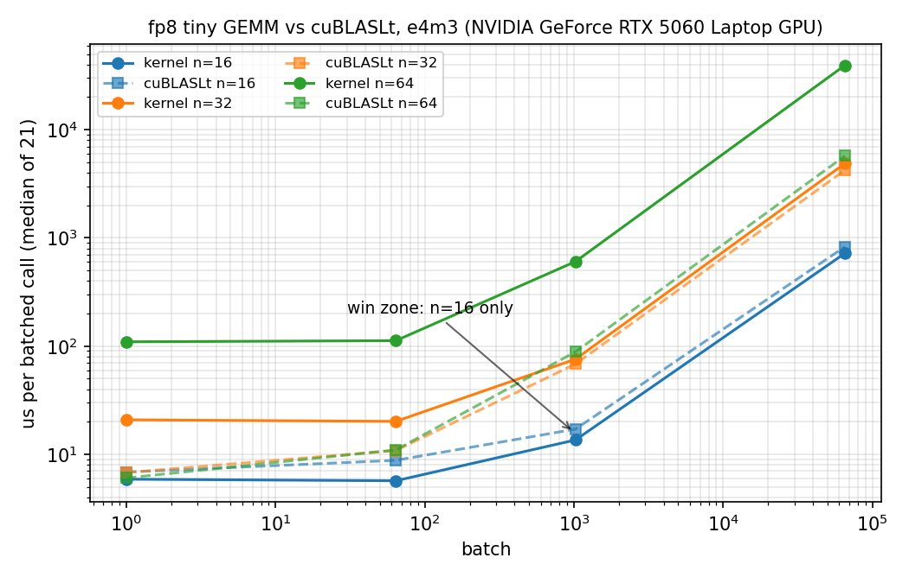

# fp8-tiny-gemm — batched tiny FP8 GEMM vs cuBLASLt (kvl benchmark #6)

Hand-written batched tiny GEMM with FP8 storage and FP32 accumulation,
measured against cuBLASLt's batched FP8 path (the library's best honest
configuration). Registered as benchmark #6 in [kernel-vs-library](https://github.com/FireHorseAutumn/kernel-vs-library).

## Claim (measured)

In the launch-tax regime a hand-written kernel — one warp per matrix,
register-resident, no workspace query, no per-call setup — was expected to
beat cuBLASLt batched FP8 for M=N=K ≤ 64. **Measured: the win zone is n=16
only.** At n=16 the kernel wins every batch point (0.75–0.85× vendor time);
at n=32 and n=64 cuBLASLt's tensor-core path wins everywhere, up to 10.9×.
The launch-tax hypothesis survives only at the smallest size tested.

## Results (RTX 5060 Laptop, sm_120, CUDA 13.2, driver 615.71.09)

µs per batched call, median of 21 with [min, max]; raw per-rep timings and
machine metadata in `data/fp8_bench.json`. Laptop, power mode not pinned.

| n | batch | kernel | cuBLASLt | kernel/lt | winner |
|--:|--:|--|--|--|--|
| 16 | 1 | 7.4 [7.0, 9.4] | 9.9 [9.5, 12.1] | 0.75 | kernel |
| 16 | 64 | 8.0 [7.4, 8.7] | 10.0 [9.8, 12.0] | 0.80 | kernel |
| 16 | 1024 | 16.0 [14.0, 18.1] | 20.3 [19.0, 21.6] | 0.79 | kernel |
| 16 | 65536 | 833.3 [828.8, 836.0] | 981.2 [916.7, 989.0] | 0.85 | kernel |
| 32 | 1 | 28.0 [26.7, 31.0] | 10.8 [10.2, 12.3] | 2.59 | cublaslt |
| 32 | 64 | 24.1 [22.8, 27.5] | 15.7 [13.5, 16.1] | 1.53 | cublaslt |
| 32 | 1024 | 81.7 [79.4, 84.0] | 71.5 [70.8, 71.9] | 1.14 | cublaslt |
| 32 | 65536 | 5931.9 [5306.2, 6067.9] | 4614.2 [4418.5, 5964.7] | 1.29 | cublaslt |
| 64 | 1 | 108.3 [107.9, 111.6] | 10.0 [9.4, 12.2] | 10.85 | cublaslt |
| 64 | 64 | 112.5 [111.3, 115.5] | 14.0 [12.6, 15.6] | 8.06 | cublaslt |
| 64 | 1024 | 672.8 [656.1, 695.2] | 104.1 [103.7, 106.1] | 6.46 | cublaslt |
| 64 | 65536 | 48336.0 [47824.1, 75029.8] | 6542.5 [6455.1, 6895.5] | 7.39 | cublaslt |

**e5m2:** cuBLASLt's heuristic offers no algo for the row-major strided
batched e5m2 configuration on this stack (recorded as `null` cells in the
JSON); kernel-side e5m2 times are in the sweep and track e4m3 within ~2%
(7% at the n=16 batch=1 launch-noise floor).

Launch-overhead exhibit (batch=1 row): the kernel's fixed cost is ~7.4 µs
vs ~10 µs for cuBLASLt — the ~2.5 µs setup tax the tiny regime amortizes.

## Accuracy (vs FP64 oracle, batch=64, fixed seeds)

Relative L2 error against an FP64 reference of the unquantized inputs,
compared to the first-principles bound u·√K (u = 2^-4 e4m3, 2^-3 e5m2;
assertion at 3× that):

| n | e4m3 rel | e5m2 rel | e5m2/e4m3 | cuBLASLt e4m3 rel |
|--:|--|--|--|--|
| 16 | 3.39e-2 | 6.74e-2 | 1.99 | 3.39e-2 |
| 32 | 3.34e-2 | 6.71e-2 | 2.01 | 3.34e-2 |
| 64 | 3.34e-2 | 6.69e-2 | 2.00 | 3.34e-2 |

Measured error is 7–14% of u·√K (2–5% of the 3× assertion bound); the
e5m2/e4m3 ratio is 2.0 as predicted by the mantissa count. cuBLASLt matches
the kernel's error to printed precision — input quantization dominates,
accumulation is FP32 on both sides. FP4 e2m1 appendix (`test_fp4_accuracy`):
measured 11.1–11.3× the e4m3 error — well above the 4× mantissa-count
prediction, because on U(-1,1) data the e2m1 grid rounds every input to
{0, ±0.5, ±1}: a quarter of the inputs become exact zeros and the error is
absolute-grid dominated, not relative-roundoff dominated. Degenerate inputs:
all-zeros give exact zeros; ±900-magnitude inputs saturate (SATFINITE
quantization, counted: ~50% of entries) with no NaN/Inf in any output.

## Status

CV-4 built and measured 2026-10-25: CTest 2/2 (correctness + FP4 appendix),
benchmark table above, win zone n=16. Per the kill criterion the table
ships as measured.

## Numerics (the point of the exercise)

- Inputs quantized to FP8 e4m3 (default) or e5m2 (flag) with round-to-
  nearest-even via CUDA 13.2 `cuda_fp8.h`; accumulation in FP32
  (CUDA cores for the kernel; tensor cores inside cuBLASLt).
- Accuracy measured against an FP64 reference: error bounds stated from
  first principles (mantissa bits × √K random-walk), not just reported.
- FP4 e2m1 appears as an ACCURACY APPENDIX only (built separately), never
  as the kernel bet.
- See the [gpu-bundle-adjustment](https://github.com/FireHorseAutumn/gpu-bundle-adjustment) precision study for why FP8 belongs in
  tensor-core-style accumulate paths and never in measurement space.

## Layout

- `docs/SPEC.md` — spec of record (kernel design, baseline config, tests)
- `include/ftg/` — device kernels and host helpers (header-only, no CUTLASS)
- `benchmarks/` — vs cuBLASLt, JSON out
- `tests/` — correctness vs FP64 oracle, error-bound assertions
- `tools/` — plots; `data/` — results

## Toolchain

CUDA 13.2, sm_120 (RTX 5060 Laptop); g++-15 host compiler (nvcc rejects
g++-16 — auto-detect block in CMakeLists). ninja + ccache.
